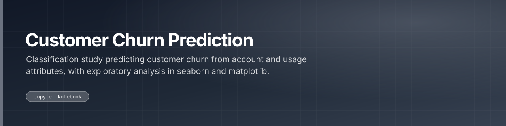

 

 

---

## What this is

Jupyter Notebook project with 1 Python module. Also checked in: 1 markdown document. The sections below are read from the repository itself, 4 tracked files as of 2023-10-31.

|  |  |
|:--:|:--:|
| **1** | **1** |
| Python modules | docs |

---

<a href="https://github.com/gowtham-creator/customer-churn-prediction">gowtham-creator/customer-churn-prediction</a>

